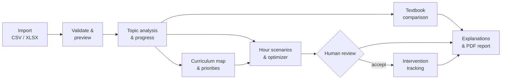
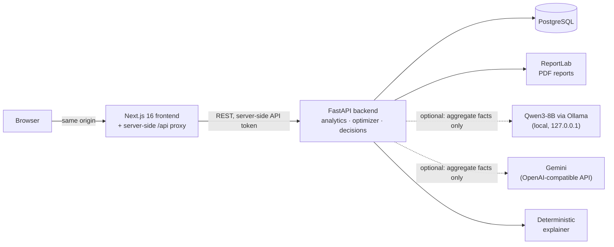

# Data-Driven Curriculum

**Curriculum analytics for schools: turn assessment results into topic-level findings, careful textbook
comparisons and teaching-hour plans that a methodologist can review and justify.**

[](https://github.com/aibaarito/data-driven-curriculum-edtech/actions/workflows/ci.yml)


Built for curriculum specialists, methodologists, teachers and school administrators. The interface is in
**Russian**. All demonstration data is **synthetic**: it is generated by a script and does not describe a real school.

[What it answers](#what-it-answers) · [Workflow](#workflow) · [Analytical approach](#analytical-approach) ·
[Architecture](#architecture) · [Quick start](#quick-start) · [Verification](#verification) ·
[Limitations](#limitations) · [Documentation](#documentation)


*Decision Center (Центр решений) on the synthetic demo dataset: each flagged topic shows its evidence, a
recommended action, the alternatives and who must review it.*

> There is no public deployment. Run the app locally ([Quick start](#quick-start)). A protected Railway deployment
> is documented in [docs/RAILWAY_DEPLOYMENT.md](docs/RAILWAY_DEPLOYMENT.md), but no public URL is published here.

## What it answers

Schools collect assessment results, but turning them into defensible curriculum changes is slow and error-prone.
The app is organised around four questions, which match the four challenge requirements:

| Question | Where in the app | What the app computes |
|---|---|---|
| Which topics need attention? | Обзор, Анализ тем | Topic mastery from item-level scores; topics classified as difficult, watch or OK against configurable thresholds and a minimum number of students |
| Are students progressing? | Анализ тем, Центр решений | Paired pre/post change per student and topic, with multiplicity-corrected confidence intervals and an explicit "not established" outcome |
| What can the evidence say about textbooks? | Сравнение учебников | Raw and baseline-adjusted differences between textbooks, using classes as the unit of inference, with listed confounders and an "insufficient evidence" verdict when the data cannot support a conclusion |
| How can teaching hours be redistributed within constraints? | Оптимизатор часов, Сценарии плана | A deterministic plan that keeps the total, min/max limits and locked topics, explains every change and requires human approval |

The app supports decisions. It does not make them: every plan has to be accepted or rejected by a person, and
no output predicts improvements in student achievement.

## Workflow



| Step | You provide or select | The app calculates or shows | Decision it supports | Important limitation |
|---|---|---|---|---|
| **Import** (Импорт данных) | A CSV/XLSX file: anonymous student IDs, classes, textbooks, assessments, item scores, hours | Row-level validation report before anything is saved. Ambiguous numbers, name-like IDs and out-of-range scores are rejected, never silently fixed | Whether the file is fit to analyse | Commit is all-or-nothing; previews expire after 60 minutes by default |
| **Overview / Topic analysis** (Обзор, Анализ тем) | Subject, grade, class, textbook, period | Mastery per topic, distributions, pre→post change with intervals, plain-language status | Which topics to examine first | Low mastery is a signal for review, not proof of poor teaching |
| **Curriculum map** (Карта программы) | Subject and grade | Prerequisite graph, weak topics that precede other weak topics, a documented priority heuristic, critical chains | Which gaps may be foundational | "Precedes" is structural, not causal. The priority score is a heuristic, not a trained model |
| **Textbook comparison** (Сравнение учебников) | Subject and grade | Raw, baseline-adjusted and gain differences between textbooks, with sample sizes, confounders and an Evidence Passport | Whether a difference is worth investigating | Observational data. With few classes, most real differences will be reported as insufficient evidence |
| **Hours optimizer and scenarios** (Оптимизатор часов, Сценарии плана) | Total hours, target mastery, locked topics, optional policy relaxation | One plan or three alternatives (conservative, balanced, gap-focused) from the same engine; constraint checks; reasons per topic | How to redistribute a fixed budget | One plan per grade; no optimality certificate; no predicted gains |
| **Decision Center** (Центр решений) | Subject and grade | Rule-based recommendations with rejected alternatives; approval, implementation and before/after evaluation of interventions | What to change and how to follow up | The before/after evaluation has no comparison group, so it cannot show that an intervention worked |
| **Explanations** (ИИ-пояснения) | The current scope | Findings that cite the computed metrics, plus limitations and next steps; labelled as model output or deterministic text | How to communicate results | Wording only: models never compute numbers. Guards are heuristic |
| **Reports** (Отчёты) | The current scope | Saved snapshot and Cyrillic PDF with observations, recommendations and limitations | Sharing with colleagues | Saved snapshots are not recomputed. They are flagged *stale* when the data changes |


*Textbook comparison (synthetic data): raw, baseline-adjusted and gain estimates, labelled as a preliminary
association with the confounders listed underneath.*


*Curriculum map (synthetic data): prerequisite chains and a documented priority heuristic. Links show programme
structure, not proven causes.*

## Analytical approach

All numbers come from deterministic backend code. Full formulas and simulations are in
[docs/ANALYTICS.md](docs/ANALYTICS.md).

* **Mastery vs. progress.** *Mastery* is the share of available points earned on outcome assessments. *Progress*
  is the paired change for the same students and topic between a baseline (`pre`) and an outcome (`post`)
  assessment of the same comparison group. A topic can be low but improving, or high but declining. The app shows
  both and never presents a decline as progress.
* **Uncertainty and multiple comparisons.** Change intervals use a Bonferroni correction over the topics in view.
  If an interval contains zero, the change is reported as *not established*, which is explicitly not evidence of
  "no effect".
* **Raw vs. baseline-adjusted textbook comparisons.** Textbooks are assigned to whole classes, so inference uses
  classes as units. The app reports the raw difference, a difference adjusted for each class's baseline, and a gain
  difference. A difference is reported only if the adjusted and gain intervals both exclude zero with the same
  sign and minimum class and student counts are met. With fewer than 10 classes, findings are labelled
  *exploratory*.
* **Insufficient evidence is a result.** When sample sizes, baselines or comparable items are missing, the app
  says so and lists the reasons instead of naming a "better" textbook.
* **Association, not causation.** The data is observational: teacher, class composition and timetable can all
  affect results. Confounders are listed next to every textbook estimate.
* **Hard constraints vs. policies.** Totals, min/max hours, locked topics and 0.5-hour steps are never relaxed.
  Policies (limited change per step, no extra hours without reliable evidence, protecting prerequisites and
  below-target topics) can be relaxed only when the user explicitly allows it. The app then reports the minimal
  set it relaxed and the topics affected.
* **Human review.** Recommendations are proposals. Accepting one whose underlying data has changed requires
  explicit acknowledgement.
* **Calculations vs. explanations.** A language model, when configured, only rewrites verified facts into prose
  through placeholders. Numbers in its output are rendered by the backend, and output that fails the checks is
  replaced by the deterministic explainer.

Example of scope labelling: on the synthetic grade 7 data, the baseline-adjusted textbook difference is
+5.1 p.p. (95% CI 1.6 to 8.6, 3 + 3 classes), labelled *exploratory*. That figure describes this generated dataset
only. Walkthroughs with more figures are in [docs/DEMO.md](docs/DEMO.md).

## Architecture



| Component | Role |
|---|---|
| **Next.js 16 · React 19 · TypeScript · Tailwind 4 · shadcn/ui · Recharts** | Prerendered pages, filters kept in the URL, charts. A server-side route forwards `/api/*` to the backend and adds the API token, so the backend URL, tokens and any model key never reach the browser |
| **FastAPI · Pydantic 2 · SQLAlchemy 2** | Import validation, analytics, textbook inference, optimizer, decision rules, scenarios, intervention lifecycle, request IDs and sanitised access logs |
| **pandas · NumPy · SciPy** | Statistical calculations as pure functions, unit-tested without a database |
| **PostgreSQL + Alembic** | Normalised schema (anonymous student IDs only); migrations are the only way tables are created |
| **ReportLab** | PDF reports with Cyrillic fonts |
| **Qwen3-8B through Ollama, or Gemini (optional)** | Natural-language explanations of facts the backend has already computed. Qwen3-8B runs locally through Ollama with no key; Gemini is reached through an OpenAI-compatible API. If output is rejected or the provider fails, the deterministic explainer is used and the UI shows which mode produced the text |

Module-level detail and the API reference are in [docs/ARCHITECTURE.md](docs/ARCHITECTURE.md) and
[docs/DECISION_INTELLIGENCE_ARCHITECTURE.md](docs/DECISION_INTELLIGENCE_ARCHITECTURE.md).

## Quick start

The route below was run on Linux with PostgreSQL 16, Python 3.13 and Node 22 on 12 November 2026. CI uses
PostgreSQL 17. A macOS helper (`./dev.sh`) with embedded PostgreSQL, plus Docker Compose notes, are in
[docs/SETUP.md](docs/SETUP.md). **The Docker images have never been built or run.**

**Prerequisites:** PostgreSQL 16+, Python 3.13, Node.js 22.

```bash
# 1. Configuration: private, git-ignored file read by the backend
cp .env.example backend/.env
# edit DATABASE_URL in backend/.env to point at an empty database you created
```

```bash
# 2. Backend: install, migrate, start on 127.0.0.1:8010
cd backend
python3 -m venv .venv && . .venv/bin/activate
pip install -r requirements.txt
alembic upgrade head    # creates or updates the schema in DATABASE_URL
uvicorn app.main:app --host 127.0.0.1 --port 8010
```

```bash
# 3. Frontend (second terminal): production build on 127.0.0.1:3010
cd frontend
npm ci
npm run build           # a cold build downloads the Inter font from Google Fonts
API_URL=http://127.0.0.1:8010 npx next start -p 3010 -H 127.0.0.1
```

Open <http://127.0.0.1:3010>, go to **Импорт данных**, download «Демо-набор (синтетический)», then preview and
confirm it (15,830 rows, 199 students). Stop either server with `Ctrl+C`; data stays in PostgreSQL.

**What changes data:** `alembic upgrade head` changes the schema; confirming an import writes rows; *Delete all
data* in Settings and the Playwright suite erase everything in the target database. The backend test suite drops
and recreates the schema of `TEST_DATABASE_URL`. Use a separate database whose name ends in `_test`.

### Configuration and AI

Configuration lives in `backend/.env` locally (root `.env` for Compose) and is never committed. See
[.env.example](.env.example) for every variable.

| Variable | Required? | Purpose |
|---|---|---|
| `DATABASE_URL` | yes | PostgreSQL connection for the backend |
| `API_URL` | frontend | Where the Next.js proxy forwards `/api/*` |
| `API_TOKEN` | optional locally, required for Compose and any shared host | Without it, the API answers loopback clients only. With it, set the same value on the backend and frontend processes |
| `ENABLE_DATA_RESET`, `ADMIN_TOKEN` | optional | *Delete all data* is enabled only when both are set (token ≥ 16 characters) |
| `DEMO_BASIC_AUTH_USER`, `DEMO_BASIC_AUTH_PASSWORD` | optional | HTTP Basic protection for the whole UI |
| `LLM_PROVIDER`, `LLM_MODEL`, `LLM_BASE_URL`, `LLM_TIMEOUT_SECONDS`, `LLM_API_KEY` | optional | Model-written explanations. `ollama` needs no key; remote providers without a key use the deterministic explainer |

To use Gemini, set these in the private file only:

```dotenv
LLM_PROVIDER=openai_compatible
LLM_BASE_URL=https://generativelanguage.googleapis.com/v1beta/openai/
LLM_MODEL=gemini-3.8-flash
LLM_TIMEOUT_SECONDS=60
LLM_API_KEY=            # set privately; never commit or paste a real key
```

The model receives aggregate facts only, with no student identifiers. If the provider times out, returns an error
or produces output that fails validation, the app falls back to deterministic explanations and reports why.

**AI evidence, stated precisely:** the project handoff records one successful live Gemini request (about 27 s)
from an earlier session. The verification in this repository used mocked provider responses (timeouts, HTTP
401/429/500, invalid envelopes, grounding violations) and deterministic mode. No live model call was made in
the current verification.

## Verification

Fresh results on the integrated `main` (12 November 2026, Linux, disposable PostgreSQL 16, deterministic mode):

| Check | Result |
|---|---|
| Backend `pytest` (fresh `*_test` database) | **283 passed**, 1 skipped (IPv6 dual-stack test; the host lacks IPv6) |
| Frontend unit tests (Vitest) | **70 passed** |
| `npm run typecheck`, ESLint | passed |
| Production build (`next build`) | passed |
| Playwright end-to-end, isolated stack (ports 8011/3011) | **19 / 19 passed** |
| Alembic migrations on an empty database | `d85f0598c8c6 → 6129d2b374e8 → b7c1d2e3f4a5` applied |

The challenge requirements are covered by named acceptance tests (`test_req1_*` … `test_req4_*` in
`backend/tests/test_core_requirements.py`), and `frontend/e2e/journey.spec.ts` drives the full journey in a browser,
from upload to PDF. Passing tests show that these specified behaviours work. They do not show that the system is
free of defects.

```bash
# backend/: destructive for the selected database only
TEST_DATABASE_URL=postgresql+psycopg://USER@127.0.0.1:5432/ddc_verify_test python -m pytest -q
# frontend/
npm run typecheck && npx eslint src e2e playwright.config.ts && npm test && npm run build
```

Browser tests require an isolated running stack. Commands, safety guards and historical results (with their
provenance) are in [docs/VERIFICATION.md](docs/VERIFICATION.md); the feature-to-test matrix is in
[docs/FEATURE_COVERAGE.md](docs/FEATURE_COVERAGE.md).

**Not verified:** Docker images, live Gemini calls in this verification, the macOS `dev.sh` route in this
session, real school data, and performance beyond the synthetic dataset.

## Limitations

* **Synthetic data only.** The demo dataset (seed 20251110, school `SYNTH-DEMO`) is generated, and the follow-up
  file used to demonstrate intervention evaluation has a +3 p.p. shift built in. Results on it prove nothing about
  real classrooms.
* **Observational inference.** Textbook and before/after comparisons show associations. Baseline adjustment
  cannot remove residual confounding, and few classes means low statistical power.
* **Access model.** A single shared API token, or loopback-only access by default. There are no user accounts,
  roles or per-school isolation. **Not suitable for real student data in its current form.**
* **External AI is optional and unverified live here.** Provider availability, quota and latency are outside the
  app's control; the deterministic explainer covers outages.
* **Modelling scope.** One hours plan per grade; no item-difficulty (IRT) model; no knowledge tracing; scenario
  plans carry no optimality certificate; the priority score and decision rules are fixed heuristics in code.
* **Localisation.** The interface is Russian; some page text is still inline rather than in the translation file.

## Documentation

| Document | Contents |
|---|---|
| [docs/SETUP.md](docs/SETUP.md) | Full setup (macOS helper, Docker notes, upgrades), access modes, LLM settings, test safety rules |
| [docs/DEMO.md](docs/DEMO.md) | Five-minute and three-minute demo scripts with synthetic-data figures |
| [docs/ANALYTICS.md](docs/ANALYTICS.md) | Formulas, statistical methods, simulation of false-positive rates |
| [docs/ARCHITECTURE.md](docs/ARCHITECTURE.md) | Modules, database schema, API reference |
| [docs/DECISION_INTELLIGENCE_ARCHITECTURE.md](docs/DECISION_INTELLIGENCE_ARCHITECTURE.md) | Evidence versioning, curriculum graph, decision rules, scenarios, interventions |
| [docs/IMPORT_FORMAT.md](docs/IMPORT_FORMAT.md) | Import columns, number parsing, integrity rules |
| [docs/VERIFICATION.md](docs/VERIFICATION.md) · [docs/FEATURE_COVERAGE.md](docs/FEATURE_COVERAGE.md) | Verification records and feature-to-test matrix |
| [docs/PRE_DEFENSE_SMOKE.md](docs/PRE_DEFENSE_SMOKE.md) | Pre-defense checklist and optional live Gemini check |
| [docs/RAILWAY_DEPLOYMENT.md](docs/RAILWAY_DEPLOYMENT.md) | Protected Railway deployment procedure (Russian) |
| [docs/LOCAL_AI.md](docs/LOCAL_AI.md) | Local Qwen3-8B through Ollama: install, local-only settings, configuration, failures |
| [docs/README_RESEARCH.md](docs/README_RESEARCH.md) | How award-winning hackathon READMEs informed this one |

## Credits and license

Natural-language explanations can optionally use Google's Gemini models through Google's
[OpenAI-compatible endpoint](https://aistudio.google.com/docs/openai); this project does not train any model.
Statistics use pandas, NumPy and SciPy; PDFs use ReportLab with DejaVu fonts.

No license has been selected for this repository yet, so default copyright applies.
